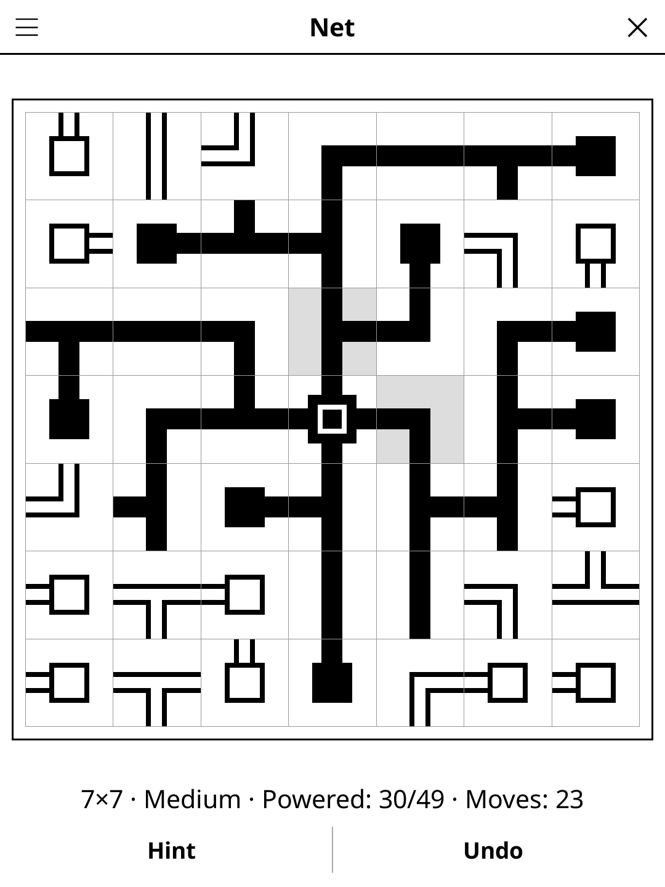

# netwalk.koplugin

Net (also known as NetWalk), after Simon Tatham's puzzle, for
[KOReader](https://github.com/koreader/koreader).

## Screenshot

## Rules

The grid holds a network of pipes that has been scrambled by turning every
tile at random. Turn the tiles back so that all of them form one connected
network: every pipe end meets a pipe end on the neighbouring tile, nothing
points off the grid, and there are no loops. Power flows from the source in
the middle; tiles it reaches are drawn solid, the others hollow.

## Features

- **Four sizes** — 5×5, 7×7, 9×9, 11×11
- **Unique solutions** — every puzzle has exactly one answer, proven by the
  generator's own solver before it is shown
- **Three difficulty levels**, rated by the reasoning needed:
  - Easy: local rules alone (pipes can't point off the grid, ends must meet)
  - Medium: also needs loop avoidance
  - Hard: also needs "a group of tiles must keep a way out" (dead ends can't
    face each other, a closed-off group is impossible). Such puzzles are
    rare on small grids: when none turns up quickly, Hard falls back to a
    Medium-grade puzzle (about half the time on 5×5, rarely from 9×9 up)
- **Any valid network wins** — the win check looks at the pipes, not at a
  stored answer
- **Lock marks** — long-press a tile you are sure of; it is shaded and won't turn
- **Rotation direction** — tap turns clockwise, or counter-clockwise (menu)
- **Hint** — two taps: the first points at a tile, the second turns it the
  right way and locks it. A tile locked the wrong way is reported first
- **Undo, Restart, Show solution**, move counter, timer and best time per
  size and difficulty (rounds without hints)
- **Auto-save** — the game is restored on next launch

## Controls

| Action | How |
|--------|-----|
| Turn a tile | Tap it |
| Lock / unlock a tile | Long-press it |
| Hint, Undo | Action bar |
| New game, size, difficulty, rotation direction, solution, restart, rules | Title-bar menu |

## Why e-ink friendly?

Turn-based, no animation; each tap redraws only the board. Power is shown by
shape (solid vs hollow pipes) rather than by colour.

## License

GPL-3.0 — see [LICENSE](LICENSE).
